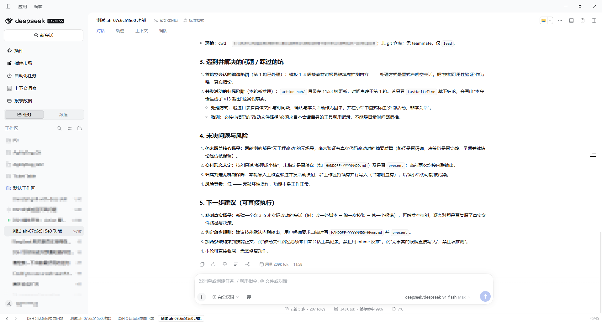

# dsh-nav-history

DSH（DeepSeek Harness）Web GUI 的**全局后退 / 前进**插件：像浏览器一样，记住你去过的每一个"页面"——包括会话（含 Agent Teams 的成员会话 / 子智能体会话）和各种插件开启的整页面板（插件市场、任务、自定义插件页……），一键回到上一个位置。

DSH 本身没有 URL 路由，也没有浏览历史：切换会话或整页面板只是替换当前视图，旧位置直接丢弃。本插件维护自己的访问栈来补上这一块。



*示例中底栏一次显示 4 个页面记录（可在 1–7 之间配置），右侧 `45/45` 为当前历史栈位置；点击任意条目可直接跳转。*

## 功能

- **全局后退 / 前进**：覆盖两类"页面"：
  - **会话**：主会话、成员会话（`origin: 'subagent'` 的子会话）、任意历史会话；
  - **整页面板**：插件注册到 `main` + `sidebar.panellist` 的页面（插件市场、任务页等），以及从面板跳回会话、会话再进面板的任意交错。
- **常驻底栏**：挂在 `shell.bottom` 根座位，跨面板常驻、不随面板切换消失，也不占用会话头部。
- **前后文可见**：底栏一次性显示当前页面及其前后的历史位置（默认 3 个，可在 1–7 之间配置），**点击任意条目可直接跳转**；当前页面高亮。
- **浏览器式快捷键**：`Alt+←` / `Alt+→`（macOS 为 `⌘[` / `⌘]`），已注册进 DSH 的快捷键系统，可在 **设置 → 通用 → 快捷键** 中查看和改键；另支持鼠标侧键（后退键 3 / 前进键 4）。
- **会话内消息定位**：`Alt+↑` / `Alt+↓` 激活右侧原生回合导航条（TurnNavigator）里相邻的标记，与用鼠标点击小杠走同一条原生路径——未加载的历史回合会自动按需加载并精确对齐；焦点在输入框内也生效，且不会让输入框失去焦点（该组合键在输入框中不再触发编辑器的段落移动）。
- **历史持久化**：按浏览器存 localStorage（键 `dsh.nav-history.v1`，上限 100 条，7 天过期），刷新页面后历史仍在。
- **纯客户端**：Host 半为空实现，不注册工具、不写提示词、不碰会话数据；只读取公开的布局 / 会话状态并调用公开的导航 API。

## 安装

从 npm 安装（推荐，大陆网络可直接使用镜像）：

```sh
dsh plugin --profile desktop add dsh-nav-history
```

从 GitHub 安装（DSH 桌面版 profile `desktop`）：

```sh
dsh plugin --profile desktop add github:AhaCrazy/dsh-nav-history
```

本地开发时可以用 `link:` 方式挂载当前目录：

```sh
dsh plugin --profile desktop add ./dsh-nav-history
```

或手动在 `~/.dsh/profiles/desktop/package.json` 中：

1. `dependencies` 增加 `"dsh-nav-history": "link:C:/Users/happyelements/Documents/dsh-plugins/dsh-nav-history"`；
2. `dsh.profile.bundles` 追加 `"dsh-nav-history"`；
3. 在 profile 目录执行 `pnpm install`；
4. 重启 DSH 桌面端（Host 需要重新组合插件行），刷新 Web 页面。

## 使用

页面底部出现一条细导航条：

```
[←] [→] │ [上一页] [当前页] [下一页]        3/7
```

- 左键点击箭头、按快捷键、或用鼠标侧键即可后退 / 前进；
- 点击中间的页面条目可直接跳到该历史位置；
- 在会话中按 `Alt+↑` / `Alt+↓` 可跳到上一条 / 下一条用户消息（等价于点击右侧原生导航条的相邻小杠）；
- 右侧 `3/7` 是历史栈位置（进入过的页面总数）；
- 标题为当前会话标题或面板名称；面板页面的标题取侧栏面板注册的 label。

## 配置

**设置 → 插件 → dsh-nav-history → 导航栏**：

- **最多显示条目数**：1–7（硬限制，越界值会被夹紧）；默认 3。
- **每个页面的最大宽度**：64–320 px（滑块，按 8 px 步进；越界值会被夹紧，默认 160 px）。标题超出部分省略显示。
- 设为 1 时只显示当前页面；大于 1 时显示当前页面前后的页面。
- 配置即时生效，并按浏览器保存在 localStorage（键 `dsh.nav-history.settings.v1`）。

## 快捷键

- 默认：Windows `Alt+←` / `Alt+→`；macOS `⌘[` / `⌘]`；
- 消息定位：Windows / macOS `Alt+↑` / `Alt+↓`（macOS 即 `Option+↑/↓`）；
- Web 与 Linux 默认不绑定（方向键在那些平台属于保留键），可在 **设置 → 通用 → 快捷键** 中手动分配；
- 焦点在输入框时同样生效，且不会使输入框失去焦点；代价是该组合键在输入框中不再执行编辑器的段落移动（如仍想保留段落移动，可在设置中把消息定位改到别的键）。
- 若要改键：设置 → 通用 → 快捷键 → 查看，搜索「后退 / 前进 / 上一条用户消息」。

## 边界与说明

- 只跟踪**主视图**的切换：右侧栏、侧边对话、设置弹窗等不进入历史（它们不改变主页面）。
- 返回面板时先恢复面板下的会话再选中面板（顺序由 DSH 公开 API 决定）。
- 面板或会话已被删除 / 归档时，该条历史在恢复失败后自动丢弃。
- 无历史或到栈顶 / 栈底时按钮置灰。
- 未跟踪会话内的 view 页签（对话 / 轨迹）切换，也不跟踪滚动位置。

## 更新记录

- **0.4.2**：修复两处问题。一是导航条在切换到有固定侧栏的界面后（例如 Bot 模式的左侧列表、右侧面板）会被侧栏压住一部分，现在导航条会实时测量主内容区的位置并自动让开，侧栏出现、收起、切换模式或拖动宽度时都保持对齐，量不到位置或窗口过窄时保持原样。二是侧边栏打开、原生消息定位栏被隐藏时，`Alt+↑` 走到对话最顶部会卡住，现在能正常触发「加载更早」。
- **0.4.1**：消息定位改为复用右侧原生 TurnNavigator——快捷键激活相邻的 mark，与鼠标点击小杠同一条原生路径（未加载回合会按需加载、精确对齐、更新阅读位置），不再用 `scrollTop` 近似，并移除自定义高亮；同时支持焦点位于输入框时触发，且不改变焦点（该组合键在输入框中不再执行编辑器的段落移动）。
- **0.4.0**：新增「上一条 / 下一条用户消息」定位（`Alt+↑` / `Alt+↓`）：直接滚动到对话中相邻的 user turn 并短暂高亮，输入框内让位给编辑器；测试新增 conversation 组。
- **0.3.0**：代码按职责拆分为 `src/` 下的多个 ES 模块（常量、文案、样式、工具、存储、历史控制器、快捷键、视图、装配），新增零依赖的 `scripts/build.mjs` 把模块拼装为浏览器所需的单文件 `client.js`；测试拆成 history / apply / build 三组，并加入 GitHub Actions 校验。行为不变。
- **0.2.3**：新增「每个页面的最大宽度」配置项（64–320 px 滑块，默认 160 px），控制底栏中每条页面记录的最大显示宽度。
- **0.2.2**：快捷键标题统一加前缀 `Nav History:`（如 `Nav History: 后退`），便于在「设置 → 通用 → 快捷键」中查找。
- **0.2.1**：修复"后退到中间位置后再打开新页面，前进分支（d/e）没有被截断"的问题——恢复动作现在同步定案，若落点与记录条目略有差异只就地重写该条目，绝不会把光标挪到栈尾；因此后退后打开新页面会正确截断旧的前进分支。另加只读诊断句柄 `window.__dshNavHistory.dump()`。
- **0.2.0**：底栏支持显示前后多个历史条目（1–7 可配置、点击跳转）；插件详情页增加「导航栏」配置卡；修复快捷键未出现在「设置 → 通用 → 快捷键」的问题（默认键位不再使用 Web 保留键导致注册失败）。
- **0.1.0**：首个版本：全局历史栈、底栏、快捷键、鼠标侧键、持久化。

## 开发

```sh
npm run build   # 从 src/ 重新生成 client.js
npm test        # 校验 client.js 是最新的 + 运行三组测试
```

代码结构：

```
src/
  constants.js  版本、键名、上下限
  locales.js    中英文案
  styles.js     底栏 / 配置卡 CSS
  utils.js      entryKey、位置读取、标题解析、偏好夹紧
  storage.js    localStorage 读写
  history.js    与 UI 无关的历史栈控制器（可单测）
  conversation.js  会话内「上一条 / 下一条用户消息」定位（激活原生 TurnNavigator 相邻 mark）
  shortcuts.js  快捷键注册、鼠标侧键
  view.js       底栏与配置卡的 React 组件工厂
  apply.js      组装模块并注册进 DSH 上下文
scripts/build.mjs  零依赖打包：拼装为 window.__ModuleLoader__ 形式的 client.js
```

`client.js` 是生成产物（不要手改）；DSH 客户端加载器只接受单个普通脚本，所以构建脚本把 `src/` 下的 ES 模块按依赖顺序内联进 loader factory，再交给 `createClientModule(React)`。
